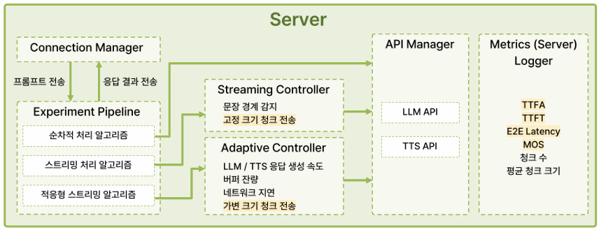
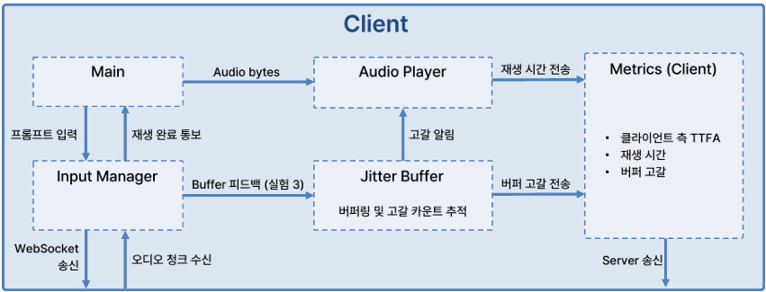
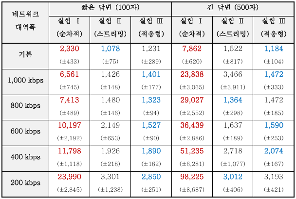
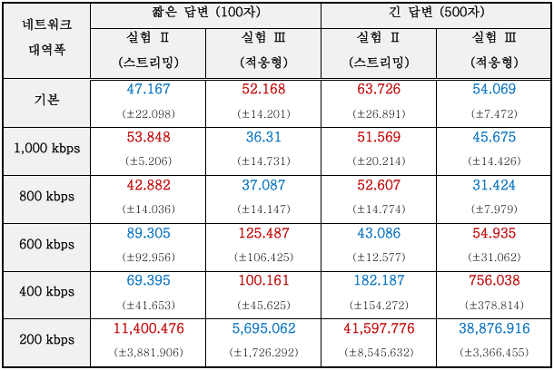
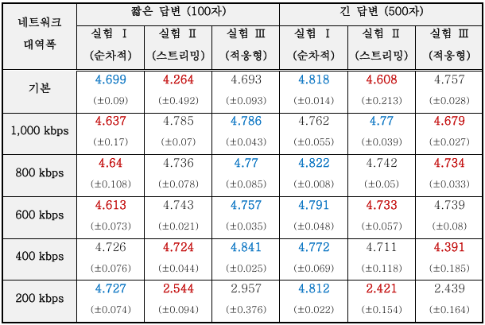

# 실시간 게임 몰입감 향상을 위한 LLM-TTS 기반 적응형 스트리밍 파이프라인 설계 및 성능 분석

**LLM-TTS 연동 환경에서 순차적 처리 · 스트리밍 · 적응형(ABR) 세 가지 파이프라인을 구현하고 지연 및 음질을 정량 비교한 프로젝트**


---

## 📋 목차

- [프로젝트 소개](#-프로젝트-소개)
- [시스템 아키텍처](#️-시스템-아키텍처)
- [실험 설계](#-실험-설계)
- [핵심 알고리즘](#-핵심-알고리즘)
- [실험 결과](#-실험-결과)
- [트러블슈팅](#-트러블슈팅)
- [저장소 구조](#-저장소-구조)
- [실행 방법](#️-실행-방법)
- [라이선스 및 기여](#-라이선스-및-기여)

---

## 🚀 프로젝트 소개

NVIDIA ACE, Ubisoft NEO NPC 등 게임 산업에서 LLM 기반 NPC 대화 시스템이 주목받고 있습니다. 이러한 시스템에서 LLM-TTS 파이프라인의 첫 음성 도달 시간(TTFA)의 지연은 플레이어의 몰입감을 직접 좌우합니다. 고정 청크 스트리밍은 순차적 처리 방식에 비해 지연 시간을 단축하지만, 청크가 과도하게 작으면 버퍼 고갈로 인해 음성이 끊기고 과도하게 크면 TTFA가 늘어난다는 트레이드오프가 존재합니다.

이 연구는 LLM 토큰 생성 속도, TTS 합성 속도, 버퍼 레벨, 네트워크 RTT 등 런타임 지표를 **ABR(Adaptive Bitrate) 가중치 합산 방식**으로 통합하여 텍스트 및 오디오 청크 크기를 실시간으로 결정하는 적응형 스트리밍 알고리즘을 설계 및 구현하고, 순차적 처리 및 고정 청크 스트리밍 방식과 성능을 정량적으로 비교했습니다.

### 프로젝트 정보

- **과목**: 정보통신 종합 설계 및 실습
- **기간**: 2026.03.01. ~ 2026.10.02.
- **구분**: 졸업논문 / 개인 프로젝트 
- **지도교수**: 전홍배 교수님

---

## 🏗️ 시스템 아키텍처




| 단계 | 실험 Ⅰ (Sequential) | 실험 Ⅱ (Streaming) | 실험 Ⅲ (Adaptive) |
|------|--------------------|--------------------|-------------------|
| LLM | 전체 대기 | 토큰 스트림 | 토큰 스트림 + 속도 추적 |
| 텍스트 청크 | — | 고정 80자 | 동적 **40~200자** |
| 오디오 청크 | 1회 전송 | 고정 12,000 bytes | 동적 **12,000~24,000 bytes** |
| 피드백 루프 | 없음 | 없음 | buffer_level + starvation_count |

---

## 🧪 실험 설계

### 실험 환경

| 구분 | 서버 | 클라이언트 |
|------|------|------------|
| **위치** | Azure VM (Ubuntu 24.04 LTS) | 로컬 머신 (Windows 11 Home) |
| **하드웨어** | Standard B2als v2, RAM 4 GB | Intel Core i5-1135G7, RAM 8 GB |
| **역할** | FastAPI, LLM/TTS API, tc netem 대역폭 제한 | 오디오 재생 (WASAPI), 루프백 녹음, MOS 평가 |

- **LLM**: OpenAI GPT-4o-mini (`openai/gpt-4o-mini-2024-07-18`, OpenRouter 경유)  
- **TTS**: ElevenLabs Flash v2.5 (`pcm-24000`, PCM 24 kHz · 16-bit signed · mono)  
- **네트워크 조건**: tc netem으로 6조건 (제한 없음/1,000/800/600/400/200 kbps)  
- **반복 횟수**: 3종 × 6조건 × 2길이(100자/500자) × 5회 = 180회

### 실험 Ⅰ — 순차적 처리 (Baseline)

```
사용자 입력 → [await] LLM 전체 완료 → [await] TTS 전체 완료 → 단일 전송
```

### 실험 Ⅱ — 고정 청크 스트리밍

```
LLM 토큰 스트림 → llm_text_chunker (최대 80자)
    → TTS 병렬 태스크 → tts_audio_chunker (무음 경계, 버퍼 상한 48,000 bytes)
        → 청크 반복 전송 → JitterBuffer (pre-buffer 5청크) → 재생
```

### 실험 Ⅲ — 적응형 스트리밍 (ABR)

실험 Ⅱ 파이프라인에 `AdaptiveController` 추가한 형태. 매 청크마다 아래 공식으로 크기를 결정합니다.

```
score = Σ(가중치 × 정규화 지표)  ∈ [0, 1]
chunk_size = MIN + score × (MAX − MIN)
← 클라이언트 buffer_feedback {"buffer_level": N, "starvation_count": M}
```

| 지표 | 텍스트 가중치 | 오디오 가중치 | 방향 |
|------|:---:|:---:|:---:|
| 버퍼 잔량 | 30 % | 40 % | 정비례 |
| TTS 합성 속도 | 25 % | 30 % | 정비례 |
| LLM 토큰 속도 | 20 % | — | 정비례 |
| 네트워크 RTT | 15 % | 20 % | 반비례 |
| 전송 처리량 | 10 % | 10 % | 정비례 |

---

## 🔬 핵심 알고리즘

### 하이브리드 텍스트 청킹 (`llm_text_chunker`)

① 문장부호 뒤 공백·줄바꿈 감지 → 즉시 yield  
② 버퍼 ≥ `max_chars` → overflow flush  
Callable 주입으로 실험 Ⅲ의 동적 크기 적용 가능

### 무음 경계 오디오 청킹 (`tts_audio_chunker`)

① PCM 진폭 절댓값 < 300인 샘플이 50 ms(2,400 bytes) 이상 연속 → 무음 경계에서 yield  
② 탐색 구간: 버퍼 앞 25 % 건너뜀 (최소 청크 길이 보장)  
③ 버퍼 ≥ `max_chunk_bytes` → overflow flush

### Producer-Consumer 순서 보장

TTS 태스크들이 병렬 실행되어도 `asyncio.Queue` 파이프라인이 오디오 전송 순서를 보장

---

## 📊 실험 결과

### TTFA 비교 (ms, 평균 ± 표준편차)



### 버퍼 고갈 지속 시간 비교 (ms, 평균 ± 표준편차)



### NISQA 불연속성 비교 (점, 평균 ± 표준편차)



### 주요 발견

- **TTFA 단축**: 800 kbps 긴 답변에서 스트리밍/적응형이 순차적 처리 대비 **약 95 % 이상** 감소 (29,027 ms → 1,364/1,472 ms)
- **안정성**: 1,000 kbps 긴 답변에서 고정 스트리밍의 TTFA 표준편차 ±3,911 ms, 적응형은 **±333 ms**로 변동성 억제
- **음질 보존**: 400 kbps 이상 전 조건에서 세 방식 모두 NISQA 4.6점 이상 유지. 기본 조건 적응형: 종합 4.92, 불연속성 4.69 (고정 스트리밍 4.70, 4.26 대비 순차 처리 수준에 근접)
- **저대역폭 한계**: 400 kbps 긴 답변에서 적응형 고갈 지속 시간 756 ms (고정 스트리밍 182 ms 대비 역전). 버퍼를 채우기 위해 청크 크기를 늘릴 때 단일 청크 전송 자체가 지연되는 현상이 원인으로, 버퍼 고갈 감지 시 즉각적 강제 축소 로직 도입이 향후 과제

---

## 🔧 트러블슈팅

<details>
<summary><b>1. 적응형 스트리밍 방식의 음성 끊김이 고정 청크 방식보다 오히려 더 자주 끊기던 문제 - ABR 피드백이 항상 "버퍼 0"으로 들어옴</b></summary>

**문제**
적응형(실험 Ⅲ)이 고정 청크 스트리밍보다 버퍼 고갈이 더 잦았습니다.

**원인**
- 클라이언트가 받은 청크를 JitterBuffer에서 즉시 drain하여 재생한 뒤에 버퍼 수위를 보고하는 방식으로 인해, 서버에는 항상 `buffer_level = 0`이 전달되었습니다. ABR 컨트롤러는 매 구간을 긴급한 상태로 판단하여 의도와는 다른 청크 크기를 설정하였습니다.
- 끊김 횟수를 실제 재생 레이어(AudioPlayer)가 아닌 JitterBuffer 기준으로 측정하여, 실제 underrun이 서버에 정확히 반영되지 않았습니다.
- 적응형 방식의 오디오 청크 상한이 고정 스트리밍과 다른 비율로 설정되어 있었습니다.

**해결**
1. 버퍼 피드백을 drain 이전에 전송하도록 순서 변경 ([390c0b3](https://github.com/ji2nook/Adaptive_Streaming_LLM_TTS_for_Games/commit/390c0b3))
2. 재생 시작 전 최소 누적 청크(pre-buffer)를 3개에서 5개로 조정 ([6c3e4fa](https://github.com/ji2nook/Adaptive_Streaming_LLM_TTS_for_Games/commit/6c3e4fa))
3. 끊김 집계 기준을 AudioPlayer로 교체하고, 오디오 청크 상한을 고정 스트리밍과 같은 1:4 비율로 통일 ([91574a5](https://github.com/ji2nook/Adaptive_Streaming_LLM_TTS_for_Games/commit/91574a5))

**결과**
현재의 가중치 합산 방식으로 확장 완료하여 적응형 스트리밍 방식의 음성 끊김을 완화하였습니다 ([3c1afbf](https://github.com/ji2nook/Adaptive_Streaming_LLM_TTS_for_Games/commit/3c1afbf)). 다만 400 kbps 이하에서는 여전히 한계가 있으며, 이는 [실험 결과 — 저대역폭 한계](#-실험-결과)에 기술했습니다.

</details>

<details>
<summary><b>2. MOS 점수가 실제로 재생된 음성을 반영하지 못하던 문제 - as-heard MOS 평가 전환</b></summary>

**문제**
MOS를 서버가 생성한 TTS 원본 WAV로 평가한 결과, 재생 중 발생한 끊김이 음성 품질 점수에 반영되지 않았습니다. 끊김이 많은 음성도 높은 점수를 받게 됩니다.

**1차 해결 방식**
클라이언트의 재생 시각을 기준으로 끊긴 구간에 강제로 무음 구간을 삽입하여 오디오를 재구성했습니다 ([59c56ac](https://github.com/ji2nook/Adaptive_Streaming_LLM_TTS_for_Games/commit/59c56ac)). 하지만 재구성한 오디오가 실제 체감 음질과 차이가 있어 평가 대상으로 부적합하다고 판단하고, 관련 코드를 전면 되돌렸습니다 ([1f37134](https://github.com/ji2nook/Adaptive_Streaming_LLM_TTS_for_Games/commit/1f37134)).

**2차 해결 방식**
Windows **WASAPI 루프백**으로 스피커에 출력되는 디지털 신호를 직접 녹음하는 방식으로 전환했습니다 ([f6fc1a7](https://github.com/ji2nook/Adaptive_Streaming_LLM_TTS_for_Games/commit/f6fc1a7)). 마이크를 쓰지 않아 외부 소음이 섞이지 않고, 녹음 라이브러리가 없는 환경에서는 기존 방식으로 자동 폴백합니다.

**결과**
측정 대상이 실제 사용자 경험과 일치하는지 검증을 완료하였고, 연구의 신뢰성을 확보하였습니다.

</details>

<details>
<summary><b>3. 반복 실험 중 서버가 OOM으로 강제 종료되던 문제</b></summary>

**문제**
Azure VM(RAM 4 GB)에서 실험을 반복하던 중 서버 프로세스가 `OOM Killed`로 인해 종료되었습니다.

**원인**
매 세션 종료 시점에 UTMOS 모델을 로드하는 구조여서, 다음 클라이언트 연결 처리와 모델 로딩이 겹칠 때 메모리 사용량이 급증했습니다.

**해결**
서버 시작(FastAPI lifespan) 시 모델을 한 번만 미리 로드해 재사용하는 싱글턴 구조로 변경했습니다 ([a3522f2](https://github.com/ji2nook/Adaptive_Streaming_LLM_TTS_for_Games/commit/a3522f2)).

**결과**
매 실험마다 별도의 서버 재시작 과정 없이 실험 전체를 완수하였습니다.

</details>

<details>
<summary><b>4. TTS 동시 요청 한도 초과로 오디오가 전혀 출력되지 않던 문제</b></summary>

**문제**
스트리밍 파이프라인에서 TTS 요청을 병렬로 보내다가 ElevenLabs API의 동시 연결 한도를 초과하면, 모든 요청이 실패하여 오디오 청크가 0이 되었습니다.

**해결**
`asyncio.Semaphore`로 동시 요청 수를 제한하였습니다. 기본으로 설정되어 있는 값은 5로, 별도의 환경변수로 조정이 가능한 수치입니다 ([6ddc503](https://github.com/ji2nook/Adaptive_Streaming_LLM_TTS_for_Games/commit/6ddc503)).

</details>

---

## 📂 저장소 구조

```
📁 Adaptive_Streaming_LLM_TTS_for_Games/
├── 📁 server/
│   ├── main.py                  # 서버 진입점 (uvicorn + tc 대역폭 설정)
│   ├── connection_manager.py    # FastAPI 앱 + WebSocket 엔드포인트
│   ├── api_manager.py           # LLM/TTS 클라이언트 싱글턴
│   ├── experiment_pipeline.py   # run_sequential / run_streaming / run_adaptive
│   ├── streaming_controller.py  # llm_text_chunker · tts_audio_chunker
│   ├── adaptive_controller.py   # ABR 제어 엔진 (AdaptiveController)
│   ├── experiment_config.py     # 청크 크기·가중치·임계값 상수
│   ├── metrics_server.py        # in-memory 지표 저장소
│   ├── logger.py                # JSON 출력 + MOS 평가 통합
│   ├── network_probe.py         # ping + tc netem 적용
│   ├── audio_utils.py           # PCM → WAV 변환
│   └── mos_evaluator.py         # UTMOS22 + NISQA 래퍼
│
├── 📁 client/
│   ├── main.py                  # 클라이언트 진입점 (실험 선택)
│   ├── input_manager.py         # CLI 입력 + 버퍼 피드백 전송
│   ├── audio_player.py          # PCM 재생 + WASAPI 루프백 녹음
│   ├── jitter_buffer.py         # FIFO 버퍼 + starvation 감지
│   └── metrics_client.py        # TTFA / 끊김 측정
│
├── 📁 tools/
│   └── evaluate_mos.py          # 오프라인 MOS 배치 평가
│
├── 📁 nisqa/                   # NISQA 모델 소스
├── 📁 weights/                 # 사전 학습 모델 가중치 (용량 문제로 저장소 미포함)
├── 📁 results/                 # 실험 결과 JSON + WAV (저장소 미포함)
└── 📁 test/                    # 모듈별 수동 검증 스크립트
```

---

## 🛠️ 실행 방법

**실행 환경 조건**
- 서버: Linux 필요 (`tc netem ` 대역폭 제한 사용, `sudo` 권한)
- 클라이언트: Windows 필요 (WASAPI 루프백 녹음 사용)
- OpenRouter API 키, ElevenLabs API 키 필요

```bash
git clone https://github.com/ji2nook/Adaptive_Streaming_LLM_TTS_for_Games.git
cd Adaptive_Streaming_LLM_TTS_for_Games

python -m venv venv
venv\Scripts\activate        # Windows
source venv\Scripts\activate

pip install -r requirements.txt
cp .env.example .env         # LLM_API_KEY, TTS_API_KEY 입력
```

**NISQA 가중치 준비** (MOS 평가에 필요, 용량 문제로 저장소 미포함)

1. [NISQA Releases](https://github.com/gabrielmittag/NISQA/releases)에서 `nisqa.tar`를 내려받습니다.
2. 프로젝트 루트에 `weights/` 폴더를 만들고 `weights/nisqa.tar`로 저장합니다.
3. NISQA 모델 소스는 이미 `nisqa/` 폴더에 포함되어 있어 별도 설치가 필요하지 않습니다.

서버(Linux)에서는 torch를 CPU 버전으로 먼저 설치하면 디스크와 RAM을 아낄 수 있습니다.

```bash
pip install torch torchaudio --index-url https://download.pytorch.org/whl/cpu
pip install -r requirements-server.txt
```

```bash
# 터미널 1 — 서버 (API warmup + 네트워크 측정 자동 수행)
python -m server.main

# 터미널 2 — 클라이언트 (1: 순차 / 2: 스트리밍 / 3: 적응형)
python -m client.main

# MOS 오프라인 평가 (results/audio/ 의 WAV 파일 평가)
python tools/evaluate_mos.py
```

---

## 📄 라이선스 및 기여

이 프로젝트의 코드는 [MIT License](LICENSE) 하에 배포됩니다. 단, 아래 외부 코드 및 모델은 각 원저작자의 라이선스를 따릅니다.

| 구성 요소 | 출처 | 라이선스 | 비고 |
|---|---|---|---|
| `nisqa/` | [gabrielmittag/NISQA](https://github.com/gabrielmittag/NISQA) | 코드: MIT ([nisqa/LICENSE](nisqa/LICENSE)) | 원본 코드를 그대로 포함 |
| NISQA 가중치 (`weights/nisqa.tar`) | 상동 | CC BY-NC-SA 4.0 | 저장소 미포함, 직접 다운로드 |
| UTMOS22 | [tarepan/SpeechMOS](https://github.com/tarepan/SpeechMOS) (원본: [sarulab-speech/UTMOS22](https://github.com/sarulab-speech/UTMOS22)) | MIT | `torch.hub`로 실행 시 자동 다운로드 |

**참고 및 크레딧**
- G. Mittag, B. Naderi, A. Chehadi, S. Möller, "NISQA: A Deep CNN-Self-Attention Model for Multidimensional Speech Quality Prediction with Crowdsourced Datasets," *Interspeech 2021*.
- T. Saeki et al., "UTMOS: UTokyo-SaruLab System for VoiceMOS Challenge 2022," *Interspeech 2022*.
- 이 프로젝트의 일부 코드는 [Claude (Anthropic)](https://claude.ai)의 도움을 받아 작성되었습니다.